<div align="center">

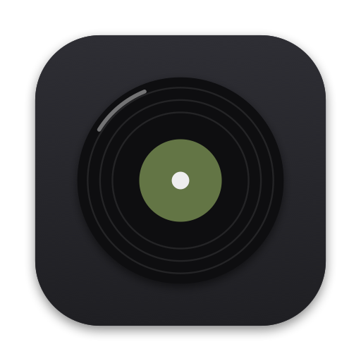

# Spindle

**A minimal music player for your own files.**<br>
mp3 · m4a · flac · wav — no accounts, no streaming, no tracking.


<br><br>

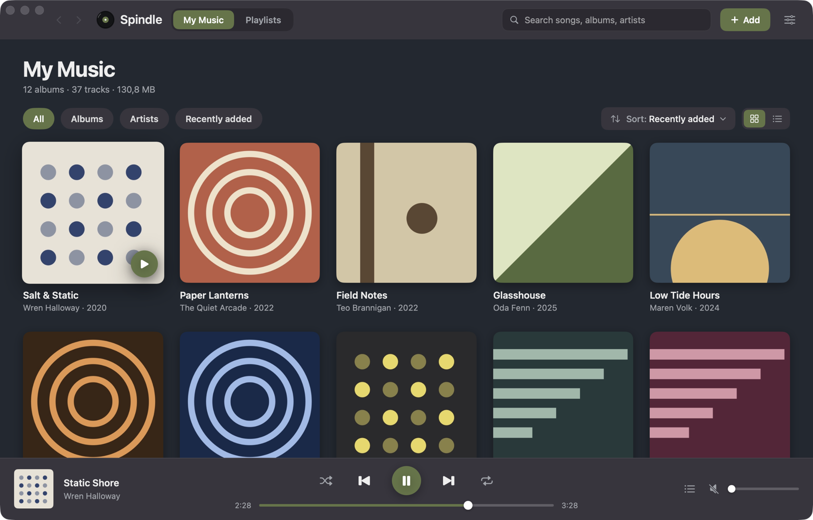

</div>

## Why Spindle

Streaming apps are great — until the music you love isn't on them: old rips, bootlegs, your own recordings, things you
bought. Spindle is a calm, fast player for exactly that. Point it at a folder and listen.

> **Status:** early MVP (v0.1). The Mac app is usable day to day; the iPhone app is next. Rough edges are expected —
> issues and ideas are welcome.

## What it does

- **Bring your music in** — pick files or whole folders, or drag them onto the window. Tags and embedded cover art are
  read automatically (ID3, iTunes/M4A and FLAC/Vorbis), duplicates can be skipped, and a live progress view shows the
  import while you keep listening.
- **Remembers your library** — files stay where they are; Spindle keeps security-scoped bookmarks, so it never asks
  for access again after a relaunch.
- **Browse your way** — an album grid or a track list, with *All / Albums / Artists / Recently added* filters, sorting
  and instant search.
- **Playlists** — create, rename, delete, give them your own cover. Add songs from a hover button or the right-click
  menu.
- **A player on every page** — play/pause, previous/next, shuffle, repeat, seek, volume. Media keys and Control Center
  work too.
- **Now Playing** — a full page with a large cover and a background tinted by the cover's dominant colour, plus a play
  queue (play next, add to queue, jump, remove).
- **Edit anything** — songs, albums and playlists, including cover pictures. Rename an album to merge it with another,
  or put every song into one album. Your files are never modified.
- **Equalizer** — ten bands from 31 Hz to 16 kHz, ±12 dB each, with twelve presets (Rock, Vocal, Bass Booster…).
  Open it from the slider icon in the player bar or the *Equalizer* button in Now Playing; changes are heard at once
  and remembered between launches.
- **Liquid Glass** — glass bars, buttons and panels (macOS 26): the player bar floats over the content, which
  scrolls underneath it, and the backdrop picks up the colours of the cover that's playing.
- **Menu bar player** — a mini player in the menu bar with the cover, seek bar, transport and volume. While it is on,
  closing the window keeps the music playing; turn it off in Settings (the gear) if you'd rather not have it.
- **Mac-native** — a *Playback* menu with Space, ⌘← and ⌘→, a single window, and a dark theme with a deliberate
  palette (`#222831` · `#637545`).

## A look around

<table>
  <tr>
    <td width="50%">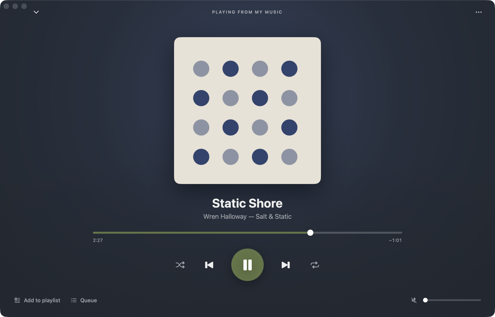<br><sub><b>Now Playing</b> — the background follows the cover</sub></td>
    <td width="50%">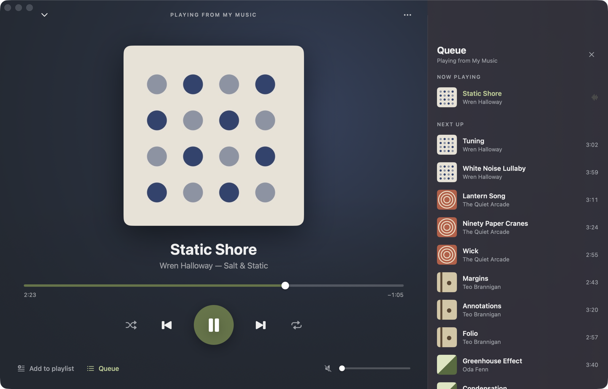<br><sub><b>Queue</b> — what's up next</sub></td>
  </tr>
  <tr>
    <td>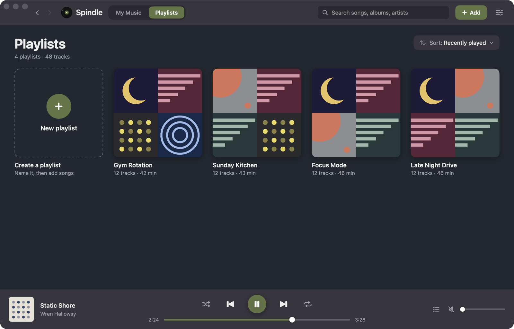<br><sub><b>Playlists</b> — automatic cover mosaics, or your own picture</sub></td>
    <td>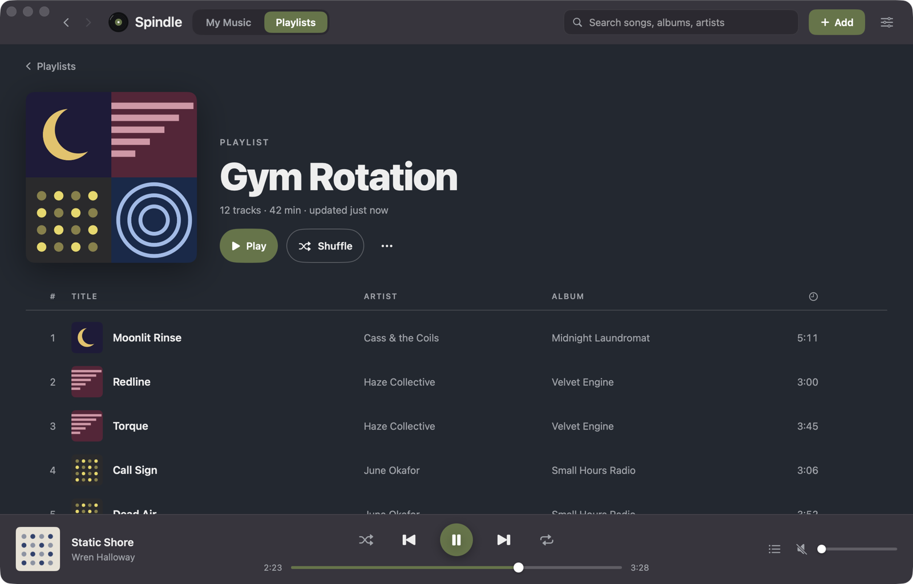<br><sub><b>Playlist</b> — play, shuffle, remove songs</sub></td>
  </tr>
  <tr>
    <td>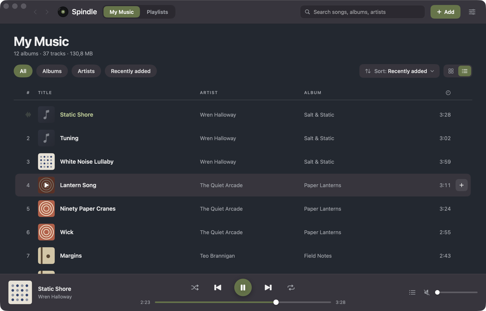<br><sub><b>List view</b> — hover for “add to playlist”</sub></td>
    <td>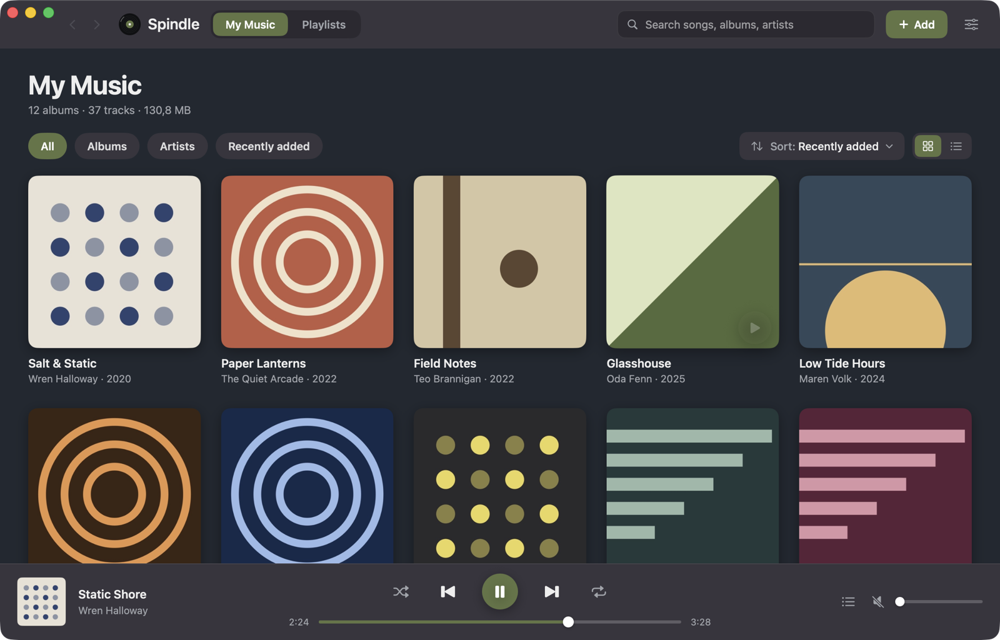<br><sub><b>Add music</b> — files, folders or drag and drop</sub></td>
  </tr>
  <tr>
    <td>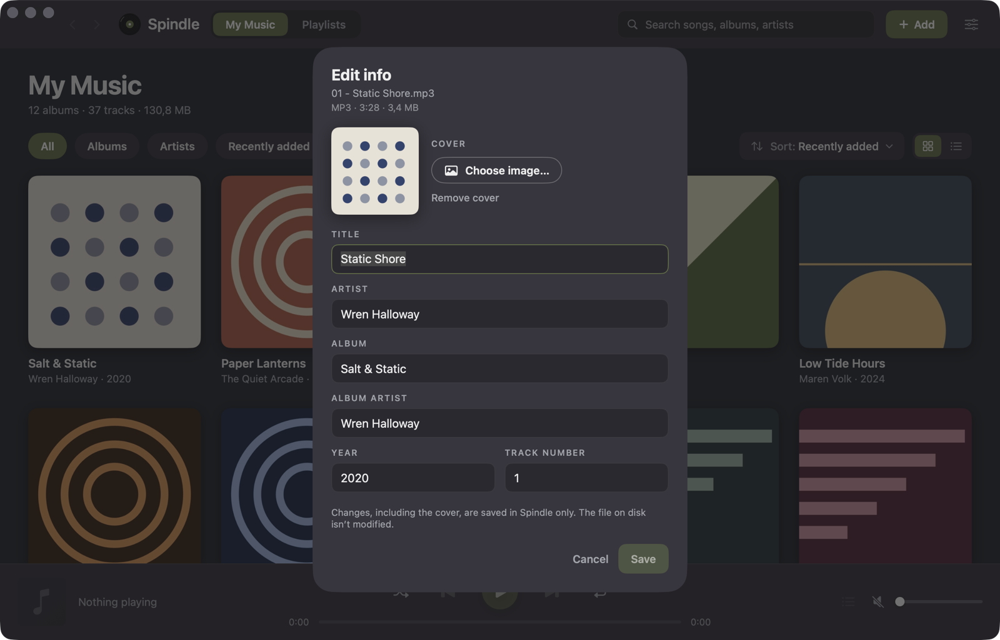<br><sub><b>Edit a song</b> — tags and cover</sub></td>
    <td>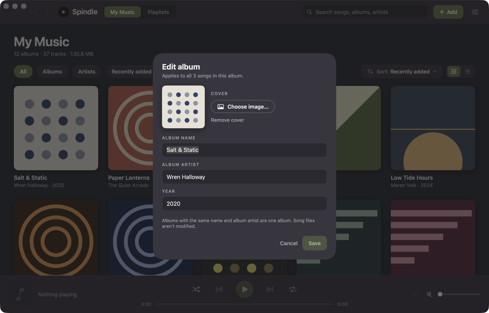<br><sub><b>Edit an album</b> — name, artist, year, cover</sub></td>
  </tr>
  <tr>
    <td>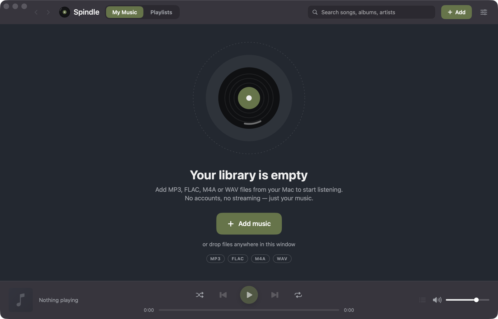<br><sub><b>First launch</b></sub></td>
    <td>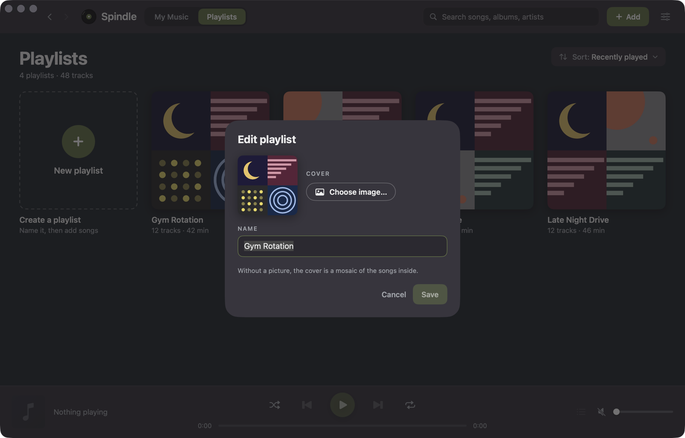<br><sub><b>Edit a playlist</b> — name and cover</sub></td>
  </tr>
</table>

The designs this follows live in [`docs/design.pdf`](docs/design.pdf).

## Get it running

**Requirements:** macOS 26+ (for Liquid Glass) and Xcode 26 (Swift 6). [XcodeGen](https://github.com/yonaskolb/XcodeGen) is only needed
to regenerate the Xcode project from `project.yml` (`brew install xcodegen`); the generated project is checked in.

```sh
git clone https://github.com/davydshcherba/spindle.git
cd spindle
open Spindle.xcodeproj          # then press ⌘R
```

### Build a standalone app

```sh
xcodebuild -project Spindle.xcodeproj -scheme Spindle -configuration Release \
  -destination 'platform=macOS' -derivedDataPath .build build
ditto .build/Build/Products/Release/Spindle.app ~/Applications/Spindle.app
```

You get a universal (Apple Silicon + Intel) `Spindle.app` of about 8 MB. It is signed ad hoc, so it runs on the Mac
that built it. To hand it to other people you'd need an Apple Developer ID and notarization.

### Where do my songs live?

Spindle never copies or moves your music. The library (titles, artists, bookmarks to the files) and a small cover-art
cache live in the app's sandbox container, `~/Library/Containers/com.spindle.Spindle/`. If a file is deleted, Spindle
tells you and skips it; removing a song from Spindle never deletes the file.

## Editing without touching your files

Spindle has **read-only** access to the files you give it, by design. Edits to songs, albums and playlists are
stored in Spindle's own library, so a wrong edit can always be undone and your tags stay exactly as they were.

| Right-click… | …to change |
| --- | --- |
| a song → **Edit Info…** | title, artist, album, album artist, year, track number, cover |
| an album → **Edit Album…** | name, album artist, year, cover — for every song in it |
| a playlist → **Edit…** | name and cover picture |

Albums are simply “songs with the same name and album artist”, so renaming an album to match another merges them.
Prefer one big album? **Settings → Put all songs in one album…** moves everything into “My songs”, and a switch in
the Add music dialog does the same for future imports.

## Under the hood

No third-party dependencies — only Apple frameworks: SwiftUI, SwiftData, AVFoundation, MediaPlayer, CryptoKit.

```
Spindle/
  Models/       Track, Playlist (SwiftData) · derived Album/ArtistGroup · store-free PlayerItem
  Services/     LibraryService   import, tags and artwork, playlists, editing
                PlayerService    AVPlayer queue, next/previous, seek, shuffle, repeat, volume
                NowPlayingService  media keys and Control Center
                ArtworkStore, CoverImporter, SecurityScopedBookmark, DominantColor, …
  ViewModels/   @Observable view models — all UI logic lives here
  Views/        SwiftUI views — layout only
  Platform/     the only AppKit: file pickers behind a small protocol
  App/          composition root and the app entry point
```

- **Ready for iPhone.** Models, services and view models have no unconditional AppKit dependency, so the same code can
  back an iOS app. Only `Platform/` and the window chrome are Mac-specific.
- **Swift 6, strict concurrency**, with main-actor isolation by default; tag reading and artwork encoding run off the
  main thread.
- **Playlists store an ordered list of track ids**, because SwiftData doesn't guarantee the order of relationships.
- **FLAC tags are parsed directly** from the file's metadata blocks instead of relying on system support.
- **Sandboxed**, with user-selected read-only file access and app-scoped bookmarks
  (see [`Config/Spindle.entitlements`](Config/Spindle.entitlements)).

## Tests

```sh
xcodebuild -scheme Spindle -destination 'platform=macOS' test
```

104 [Swift Testing](https://developer.apple.com/documentation/testing) tests cover importing, tag reading, playback,
queue behaviour, playlists, editing and the view models. Audio fixtures (MP3, M4A, FLAC with tags and cover art) are
generated in code, so the repo ships no binary test files.

Debug builds also understand a few launch variables for setting up a screen quickly — see
[`DebugLaunch.swift`](Spindle/App/DebugLaunch.swift). They are compiled out of Release builds.

## Roadmap

Ideas, not promises:

- [ ] iPhone app, reusing the models, services and view models
- [ ] The turntable “vinyl” Now Playing from the design
- [ ] Gapless playback
- [ ] Light theme
- [ ] Optionally write edited tags back into the files (needs read-write access)

## Built in public

Spindle is built in public by [Davyd](https://github.com/davydshcherba) from Ukraine 🇺🇦 — wins, fails and real
numbers. Watch the repo or open an issue to follow along or say hi.

## License

[MIT](LICENSE) © Davyd Shcherba
